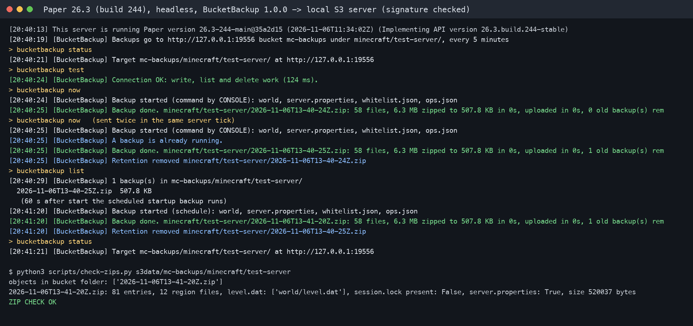

# BucketBackup

Scheduled world backups for Paper servers, uploaded to any S3-compatible storage: Cloudflare R2, AWS S3, Backblaze B2, Wasabi, MinIO, Hetzner or DigitalOcean Spaces. One jar, no extra libraries, free and open source (MIT).



## Why

A backup on the same disk as the server dies with that disk. Hosts lose nodes, people run `rm -rf` in the wrong folder, and a griefed world often needs a copy from three days ago. Object storage is cheap (R2 has no egress fees and a free tier of 10 GB), but most backup plugins only write zips to the local disk, or speak FTP and Google Drive. BucketBackup talks S3 directly.

## What it does

- Zips every loaded world (or the ones you list) plus extra files such as `server.properties`, then uploads the zip to your bucket.
- Pauses world auto-save while it zips and turns it back on before the upload starts, so the copy is consistent and the upload does not hold anything up.
- Uploads big worlds in parts (multipart upload) and retries failed parts. A failed upload is aborted so no half files stay in the bucket.
- Checks that the new backup is in the bucket listing with the right size before it deletes anything old.
- Retention keeps the newest N backups and can also drop backups older than N days. It only deletes files that match its own name pattern inside its own folder. The newest backup is never deleted.
Safety and setup:

- Checks free disk space before it zips and stops with a clear message if the temporary zip would not fit.
- Optional Discord webhook message on failure (or on every backup).
- Secrets can come from the env variables `BUCKETBACKUP_ACCESS_KEY` and `BUCKETBACKUP_SECRET_KEY`, so they stay out of config files and out of your backups.
- Works with the Paper 26.x world layout. Paper 26.x reports `world/dimensions/minecraft/overworld` as the world folder, and BucketBackup walks up to `world/` so `level.dat`, player data and `data/` are in the zip too.

## Install

1. Put `BucketBackup-1.0.0.jar` in `plugins/` and start the server once.
2. Create a bucket and an access key that can read and write only that bucket (steps for R2 below).
3. Edit `plugins/BucketBackup/config.yml`: `endpoint`, `region`, `bucket`, and the keys (or the env variables).
4. Run `/bucketbackup reload`, then `/bucketbackup test`. It writes, lists and deletes a small test file.
5. Run `/bucketbackup now` for the first backup. After that the schedule runs every `interval-minutes` (default 360).

### Cloudflare R2 in 5 minutes

1. In the Cloudflare dashboard open R2 Object Storage and create a bucket, for example `mc-backups`.
2. Open "Manage API tokens", create a token with "Object Read & Write" for that one bucket, and copy the Access Key ID and Secret Access Key.
3. Set `endpoint: https://<account-id>.r2.cloudflarestorage.com`, `region: auto`, `bucket: mc-backups`.

For AWS use `endpoint: https://s3.<region>.amazonaws.com` and the bucket's region. For Backblaze B2 use the S3 endpoint shown on the bucket page and an application key limited to that bucket.

Tip: add a lifecycle rule on the bucket that aborts incomplete multipart uploads after 1 day. BucketBackup aborts its own failed uploads, but a server crash in the middle of an upload can still leave parts behind.

## Commands

All commands need the permission `bucketbackup.admin` (ops have it). The alias is `/bbackup`.

| Command | What it does |
|---|---|
| `/bucketbackup now` | Start a backup now |
| `/bucketbackup status` | Target, next scheduled run, last success, last error, folders that will be backed up |
| `/bucketbackup list` | The newest 10 backups in the bucket with their sizes |
| `/bucketbackup test` | Write, list and delete a test file to check keys and permissions |
| `/bucketbackup reload` | Read `config.yml` again and print any config problems |

## Restore

1. Stop the server.
2. Download the zip you want from your bucket (dashboard, `rclone`, `aws s3 cp` or any S3 client).
3. Move the current world folders away (do not delete them yet), then unzip the backup in the server folder. Paths inside the zip are relative to the server folder, for example `world/level.dat`.
4. Start the server and check the world. Delete the old folders when you are happy.

## Config

The default `config.yml` has a comment on every key. The main ones:

| Key | Default | Meaning |
|---|---|---|
| `storage.endpoint` | empty | S3 endpoint without the bucket name |
| `storage.path-style` | `auto` | Path-style URLs for every provider except `amazonaws.com` |
| `backup.interval-minutes` | 360 | 0 turns the schedule off, minimum 5 |
| `backup.on-startup` | false | One extra backup 1 minute after start |
| `backup.worlds` | `'*'` | World names, or `'*'` for all loaded worlds |
| `backup.prefix` | `minecraft/my-server` | Folder in the bucket. Use one prefix per server |
| `retention.keep-last` | 14 | Newest backups to keep |
| `retention.max-age-days` | 0 | Also delete backups older than this (0 is off) |
| `upload.part-size-mb` | 16 | Part size for multipart uploads (5 to 512) |
| `notify.when` | failure | `failure`, `always` or `never` for the Discord webhook |

## Compatibility

Tested on Paper 26.3 (build 244) and Paper 1.21.11 (build 132) with the same jar. The jar is Java 21 bytecode and uses only the Bukkit API, so it should also run on Purpur and other Paper forks from 1.21 on. Folia is not supported yet (it uses the Bukkit scheduler).

Paper may log "A manual (plugin-induced) save has been detected" once. That is Paper telling you a plugin asked for a world save, which BucketBackup does on purpose before each zip.

## How it was tested

- 23 unit and integration tests (`gradle test`). The SigV4 signer is checked against the three signature examples in the AWS S3 docs.
- `scripts/test-s3.sh` runs the integration tests against `rclone serve s3`, a real S3 server that rejects bad signatures: a 12 MB multipart upload is read back byte for byte, retention runs over three backups, and a wrong secret gets HTTP 403.
- `scripts/real-run.sh` downloads the official Paper jar, checks its SHA-256, starts a headless server with the plugin, runs every command, waits for the scheduled backup, stops the server and checks the zip in the bucket (CRC, `level.dat`, region files, no `session.lock`).

## Build

```
gradle build          # needs JDK 21 or newer, writes build/libs/BucketBackup-1.0.0.jar
scripts/test-s3.sh    # tests plus the S3 integration test (needs rclone)
scripts/real-run.sh   # real Paper run (needs JDK 25 and rclone)
```

## Support the project

BucketBackup is free, and every feature in it stays free. If it saved your world, you can support the work on [GitHub Sponsors](https://github.com/sponsors/theluckystrike). Bug reports and feature requests go to the issue tracker.

## More from Zovo

If you also work with server data in VS Code, [CSV Viewer, Excel Viewer & Parquet Viewer](https://marketplace.visualstudio.com/items?itemName=zovo.table-viewer-vscode) opens exported stats and logs as a sortable table.

## License

MIT. See `LICENSE`.
